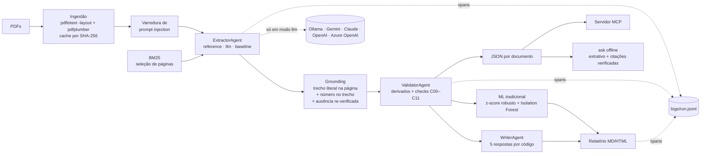

# Intra · Analisador de Demonstrações Financeiras (Light · Millet · Brasal)

Pipeline que lê 3 PDFs financeiros, extrai indicadores **com página e trecho de origem**, valida inconsistências **sem corrigi-las em silêncio**, analisa o comentário da administração, responde 5 perguntas (e perguntas livres) com citações e gera um relatório consolidado.

> **Leia primeiro (descoberta sobre os dados):** os 3 PDFs são **demonstrações financeiras anuais de 2022 (vs 2021)**, não releases trimestrais. Só a Light inclui Relatório da Administração. Por isso EBITDA, margem EBITDA, dívida líquida e guidance aparecem muitas vezes como **"não encontrado"** — e isso é o resultado correto, não uma falha. Veja "Premissas".

## O que foi de fato verificado (e o que não foi)

| Item | Status | Como foi verificado |
|---|---|---|
| Pipeline completo em modo `reference` (sem LLM) | ✅ executado | `python -m finanalyzer run` → 150 evidências, 0 falhas de grounding, 19 alertas |
| Valores contra o PDF, **sem usar o código do pipeline** | ✅ executado | `scripts/verify_numbers.py`: 71 valores, 0 falhas; derivados recalculados batem |
| Testes automatizados | ✅ **106 passam** | `python -m pytest -q` (grounding, injection, validações com dados sintéticos, clientes HTTP, relatório, log…) |
| Caminho LLM **com modelo falso** e **servidor HTTP falso** | ✅ executado | `tests/test_llm_path.py`, `tests/test_llm_http.py`: formato de requisição/resposta, *retry*, tokens, barreira do grounding contra valor inventado |
| Caminho LLM **com modelo real** | ✅ **executado** com `gemini-3.5-flash-lite` (camada gratuita, 13/11/2026) | `scripts/run_llm_full.sh` → `outputs_llm/`: recall 78,6%, precisão 100%, alucinação 0% contra o gabarito (seção "Avaliação de qualidade"). Ollama, Claude, OpenAI e Azure OpenAI usam o mesmo código, mas **não foram testados com chave real** |
| Gabarito `data/reference/` | ⚠ montado com ajuda de IA | cada trecho é checado por código contra o PDF; **confira ~8 valores à mão** (guia, Parte C) |
| Docker | ✅ build e testes validados em container (106 passed; `run` OK) | `docker build -t intra-fin-analyzer .`; ver "Docker" |
| Preços de token | ⚠ placeholders | o custo real é medido por execução em `run_manifest.json` |

## Início rápido

Requisitos: Python 3.11+, `poppler-utils` (comando `pdftotext`).

```bash
pip install -r requirements.txt
# coloque os PDFs em data/input/ com estes nomes: light.pdf  millet.pdf  brasal.pdf

python -m finanalyzer run                     # modo padrão "reference": sem LLM, sem chave → outputs/
python -m pytest -q                           # 106 testes
python -m finanalyzer eval --mode baseline    # mede a qualidade do extrator regex contra o gabarito
python scripts/verify_numbers.py              # re-confere cada valor direto no PDF e recalcula os derivados
python scripts/check_secrets.py               # garante que não há chave no repositório
python -m finanalyzer ask "Qual empresa tem a maior receita líquida?"   # pergunta livre, OFFLINE (sem LLM)
```

> **Como os `outputs/` entregues foram gerados:** em modo `reference` — extração e análise qualitativa vêm de um **gabarito verificado** (`data/reference/`); o pipeline **não chama LLM**: ele valida, deriva, responde e escreve o relatório. A extração por LLM é o modo `--mode llm`.

### Rodar o LLM **sem chave paga** (duas opções)

O código fala com qualquer modelo pela mesma interface (`LLMClient.complete`); trocar de provedor é configuração em `.env`.

**Opção 1 — Ollama (modelo open source local, sem conta, sem chave, dados não saem da máquina)**

```bash
curl -fsSL https://ollama.com/install.sh | sh       # instala (Linux/WSL); no Windows: instalador em ollama.com
ollama pull qwen2.5:7b-instruct                      # ~5 GB; alternativa: llama3.1:8b (confira os nomes em ollama.com/library)
cp .env.example .env
# edite o .env:  LLM_PROVIDER=ollama   LLM_MODEL=qwen2.5:7b-instruct   OLLAMA_NUM_CTX=32768
bash scripts/run_llm_full.sh                         # smoke-llm → eval --mode llm → run --mode llm, tudo em outputs_llm/
```
(equivale a rodar `smoke-llm`, `run --mode llm` e `eval --mode llm` com `OUTPUT_DIR=outputs_llm`, para **não sobrescrever** a execução em modo `reference` de `outputs/`. As respostas do modelo ficam num **cache em disco** (`data/cache/llm`): se a execução cair no meio por 503/429, o script já repete sozinho o passo que falhou (`TENTATIVAS`, `PAUSA`), e se desistir basta rodar de novo: ela continua de onde parou; o `eval` reaproveita a extração do `run` sem gastar cota. No `run_manifest.json`, `chamadas_do_cache` informa quantas chamadas vieram do cache — nesses casos os tokens são os medidos na chamada original e a latência é 0. `LLM_CACHE=0` desliga o cache para medir tempo/custo do zero.)
Cautelas honestas: modelos pequenos acertam menos que modelos grandes (por isso existe o grounding — ele barra o que não está na página); sem GPU a execução pode levar vários minutos por documento (não medi); o contexto de ~13–17 mil tokens por documento exige `OLLAMA_NUM_CTX` alto (o cliente aborta com mensagem clara se o prompt encher o contexto, em vez de truncar em silêncio); no WSL2 pode ser preciso liberar memória em `.wslconfig`.

**Opção 2 — Google Gemini (chave gratuita do Google AI Studio, sem cartão)**

```bash
# crie a chave em https://aistudio.google.com/apikey  e coloque no .env (NUNCA no código):
#   LLM_PROVIDER=gemini   GEMINI_API_KEY=...   LLM_MODEL=<modelo gratuito atual listado no AI Studio>
bash scripts/run_llm_full.sh
```
Cautelas: os nomes de modelo e os limites da camada gratuita mudam com frequência (liste os modelos da sua conta com `curl -s "https://generativelanguage.googleapis.com/v1beta/openai/models" -H "Authorization: Bearer $GEMINI_API_KEY" | grep '"id"'`; modelos novos podem devolver 503 por excesso de demanda e cada modelo tem cota gratuita própria — erro 429); modelos que "pensam" (Gemini 3.x) gastam parte do limite de saída raciocinando, por isso use `LLM_MAX_TOKENS=16384` ou mais (o cliente acusa resposta cortada em vez de aceitar JSON incompleto); **não** exporte o `.env` para a sessão do terminal (`set -a; . .env`): variáveis do ambiente têm prioridade sobre o arquivo e mascaram suas edições; na camada gratuita o conteúdo enviado pode ser usado pelo Google para melhorar produtos — aqui são demonstrações financeiras de companhias abertas, mas **não use esse caminho com documentos confidenciais**. Qualquer outra API compatível com `/chat/completions`: `LLM_PROVIDER=openai_compatible`, `LLM_BASE_URL`, `LLM_API_KEY`.

**Com chave paga (Anthropic / OpenAI / Azure OpenAI):** `LLM_PROVIDER=anthropic|openai|azure_openai` + a chave correspondente no `.env` (`pip install anthropic` ou `openai`).

Depois de rodar com um modelo real, atualize a tabela da seção **Avaliação de qualidade** com os números medidos (`outputs_llm/avaliacao_llm.json`, tokens e tempos em `outputs_llm/run_manifest.json`).

### Demais comandos

```bash
python -m finanalyzer ask "..." --mode llm   # pergunta livre sintetizada por LLM, com citações checadas
python -m finanalyzer serve-mcp              # servidor MCP (stdio) sobre os resultados
python -m finanalyzer scan                   # varredura de prompt injection nos PDFs
```

### Docker
```bash
docker build -t intra-fin-analyzer .
docker run --rm -v "$PWD/data/input:/app/data/input" -v "$PWD/outputs:/app/outputs" intra-fin-analyzer             # reference
docker run --rm --env-file .env -v "$PWD/data/input:/app/data/input" -v "$PWD/outputs:/app/outputs" intra-fin-analyzer run --mode llm
docker run --rm --entrypoint python intra-fin-analyzer -m pytest -q
```
O `Dockerfile` roda como usuário não-root e as chaves entram só por `--env-file`/`-e`. **Build e testes validados em container**: `docker build` OK, `pytest` dentro da imagem com 106 passed e `run` em modo reference com 150 evidências e 0 falhas de grounding. O modo `llm` em container usa o mesmo código, mas não foi exercitado lá; o caminho local (`pip install`) continua sendo o principal.

### O que sai em `outputs/`
| Arquivo | Conteúdo |
|---|---|
| `extracao/{light,millet,brasal}.json` | indicadores com `origem{pagina, trecho}`, "não encontrado" explícito, derivados rotulados, validações |
| `qualitativo/*.json` | motivos, riscos, guidance, eventos, tom + justificativa, cada item com evidência |
| `respostas.md` / `.json` | as 5 perguntas com citações documento+página |
| `relatorio.md` / `.html` | resumo executivo (≤5 linhas/empresa), tabela comparativa, qualitativo, respostas, alertas, Anexos A (derivados), B (ML tradicional vs regras/LLM), C (metodologia) |
| `ml_tradicional.json` | detecção estatística de anomalias (z-score robusto + Isolation Forest) e tom por léxico |
| `avaliacao_baseline.json` | métricas de qualidade da extração |
| `run_manifest.json` | SHA-256 dos PDFs, tempos, grounding, tokens/custo de LLM |
| `logs/run.jsonl` | log estruturado: um registro por etapa/documento/chamada de LLM (sem texto de PDF nem segredos) |

## Arquitetura



Três papéis explícitos em `finanalyzer/pipeline.py`:

- **ExtractorAgent** — produz a extração (gabarito verificado, LLM ou regex baseline).
- **ValidatorAgent** — grounding + validações determinísticas + indicadores derivados.
- **WriterAgent** — responde às perguntas e monta o relatório **por código**, com dados já verificados: nenhum número novo nasce na redação.

## Decisões e trade-offs

| Eixo | Decisão | Por quê | Custo / alternativa |
|---|---|---|---|
| **Extração** | `pdftotext -layout` + pdfplumber | Layout preserva colunas numéricas; pdfplumber captura tabelas com bordas | Millet: 0 tabelas detectadas (sem bordas) — o texto com layout cobre; OCR não foi necessário (PDFs com texto). Escaneados → Azure AI Document Intelligence |
| **Extração** | Valores em **escala original** + conversão só para comparar | Evita erro de ×1.000 e permite detectar "mil vs milhões" (C03) | Mais campos no JSON |
| **Chunking** | **Página inteira**, sem fatiar | A página é a unidade de citação exigida (documento + página); fatiar quebraria linhas de tabela e a rastreabilidade | Páginas densas gastam mais tokens; em escala, reranking antes do LLM |
| **Recuperação** | BM25 (até `MAX_PAGES`=18 páginas por documento: demonstrações + top-k por consulta) | 218 páginas cabem em memória; termos financeiros são lexicais; determinístico, explicável, sem custo de tokens | Em escala: busca híbrida (BM25 + vetor) no Azure AI Search |
| **Prompts** | Papel + regras curtas e verificáveis; documento dentro de `<documento id="..." pagina="N">` tratado como **dado**; saída em JSON com schema; `temperature 0`; "não encontrado" é resposta válida e exige motivo; **proibido estimar/calcular** (cálculos são do código) | Cada regra corresponde a uma barreira mecânica depois (schema, grounding, derivados). Regra sem verificação seria só esperança | Prompts em PT-BR; sem *few-shot* (aumentaria tokens e viés para os 3 documentos); a robustez vem do grounding, não do prompt |
| **Orquestração** | Orquestrador linear simples (sem LangGraph/AutoGen) | Fluxo é extrair → validar → escrever; auditável e testável por etapa | Se houver laços (re-extrair campos reprovados), migrar para LangGraph ou Azure AI Foundry Agent Service |
| **Redação** | Respostas e relatório **por código** sobre dados verificados | Zero alucinação na redação; reprodutível | Menos fluente; `ask` cobre perguntas abertas (offline extrativo ou LLM com citações checadas) |
| **Derivados** | Separados e rotulados "calculado ¤" | O PDF não traz EBITDA da Millet/Brasal; comparar exige calcular, mas nunca misturar com o publicado | O leitor precisa ler a fórmula (Anexo A) |
| **LLM × ML tradicional** | Os dois, lado a lado (Anexo B) | Mostra o que cada um enxerga (abaixo) | Sem rótulos suficientes (n=3) para classificador supervisionado — ver abaixo |

### ML tradicional × LLM × regras (comparação medida)

`finanalyzer/ml_baseline.py` implementa a abordagem **sem LLM e sem rótulos**: extrai as linhas das demonstrações (DRE, balanço, fluxo de caixa), calcula a variação `log(|2022| / |2021|)` e sinaliza atípicas com **z-score robusto (mediana/MAD, |z| ≥ 3,5)** e **Isolation Forest** (scikit-learn, `contamination=0.05`). Para o tom, um **léxico** de palavras positivas/negativas é comparado com o tom classificado.

Resultado desta execução (`outputs/ml_tradicional.json`, Anexo B do relatório):

| Documento | Linhas pontuadas | z-score | Isolation Forest | Ambos | Coincidem com alerta de regras |
|---|---|---|---|---|---|
| Light | 104 | 7 | 5 | 3 | 0 |
| Millet | 61 | 4 | 3 | 3 | 0 |
| Brasal | 66 | 6 | 4 | 3 | 2 |

Leitura honesta: o ML estatístico acha **linhas de movimento grande** (ex.: swaps da Light 396.946 vs 3.975, p.19) — bons candidatos a revisão — mas **não vê** o que as regras e a leitura do texto pegam: o EBITDA com sinal omitido (C04), o comparativo "não auditado" da Brasal, a Alibra consolidada só desde jun/2021. Quase não há sobreposição, ou seja, as abordagens são **complementares**: ML para *varrer* sem viés de leitura, regras/LLM para *explicar*. O léxico concorda com o tom classificado em 2 de 3 documentos (discorda na Millet: léxico "negativo", análise "neutro"/confiança baixa — um bom exemplo de por que léxico sozinho engana).

**Por que não treinei um classificador supervisionado?** São 3 documentos e nenhum rótulo; qualquer acurácia seria ruído. O que existe é honesto: método não supervisionado, parâmetros fixos, resultado reportado e comparado.

## Como evitamos alucinação (camadas)

1. **Saída estruturada obrigatória** (Pydantic): todo valor exige `pagina` + `trecho`.
2. **Grounding mecânico**: o trecho tem de existir **literalmente** na página citada **e** conter o número extraído. Falhou → valor rebaixado para "não verificado", nunca aceito.
3. **"Não encontrado" é resposta válida** e exige motivo; a ausência é **re-verificada** buscando os termos no PDF inteiro (se o termo existe, vira alerta).
4. **Indicadores calculados** carregam fórmula e insumos com página; ficam em campos separados dos publicados.
5. **Validações C00–C11** *sinalizam* divergências (nunca sobrescrevem; há teste de que a validação não altera a extração): variação %, variação absoluta, escala (mil × milhões), sinal do EBITDA, margem publicada × calculada, dívida líquida = bruta − caixa, valores extremos, anomalias do documento. Todas exercitadas com **dados sintéticos** em `tests/test_validate_synthetic.py` (nos PDFs reais nem toda regra dispara — p.ex. ninguém publica margem EBITDA —, então os testes provam que ela alertaria se existisse).
6. **Verificação independente** (`scripts/verify_numbers.py`): relê cada página citada com `pdftotext` puro, sem o código do pipeline — 71 valores, 0 falhas.
7. **Teste adversarial**: `tests/test_llm_path.py` simula um LLM que inventa um lucro — o grounding o barra.
8. **Parsing tolerante da saída do LLM** (`llm/lenient.py`): se o modelo errar o formato de UM item (ex.: anomalia sem `id`, número como texto), só esse item é descartado — com *warning* no log — e o resto do documento é aproveitado. Nunca se inventa conteúdo para "consertar" o JSON; item descartado = "não encontrado".
9. **Verificador tolerante a layout, nunca a conteúdo**: PDFs quebram rótulos longos em duas linhas e o modelo cita o rótulo "arrumado". O grounding aceita só se **todas** as palavras e números da citação (com multiplicidade) estiverem juntos numa janela curta da página, e então **troca a citação pelo texto real do PDF**. Citações que unem linhas com " | " ficam só com o segmento verificado que contém o valor. Número ou palavra trocados continuam reprovados (testes adversariais em `tests/test_grounding.py`).
10. **`ask` offline**: só devolve linhas que existem no documento; sem cobertura mínima dos termos da pergunta responde "Sem evidência suficiente" (ex.: "preço do bitcoin").

Exemplo real: a Light imprime "EBITDA R$ 1.180 mi" (p.9), mas EBIT + D&A das DFs dá **−R$ 1.179,6 mi**. O pipeline **mostra os dois e alerta** (C04, severidade alta) em vez de escolher um em silêncio.

## Avaliação de qualidade

`python -m finanalyzer eval --mode baseline` compara um extrator **regex** (sem LLM) com o gabarito:

| Métrica (28 valores esperados) | Baseline regex | LLM v1 (verificador estrito) | LLM v2 (verificador tolerante a layout, escala corrigida pelo trecho) | **LLM final** (v2 + prompt de capex/colunas) |
|---|---|---|---|---|
| Recall | 64,3% (18) | 67,9% (19) | 82,1% (23) | **78,6% (22)** |
| Precisão | 94,7% | 90,5% | 85,2% | **100%** |
| Página correta entre os corretos | 94,4% | 100% | 100% | **90,9%** |
| Alucinações (valor errado entre os preenchidos) | 0% | 0% | 11,1% (3 valores) | **0%** |

Modelo: `gemini-3.5-flash-lite` (camada gratuita do Google AI Studio), temperatura 0, mesma entrada e mesmo gabarito em todas as colunas. Cada coluna é uma iteração real do ciclo *medir → ver os erros → corrigir*; os números de todas ficam aqui de propósito, porque **a v2 subiu o recall mas deixou passar três erros** e a versão final os troca por "ausente" (preferir ausência a número errado).

O que a avaliação ensinou:

1. **Grounding estrito demais perde acerto.** O PDF quebra rótulos longos em duas linhas e o modelo cita o rótulo "arrumado" (a v1 reprovava valores corretos). O verificador passou a aceitar quando **todas** as palavras e números da citação estão juntos numa janela curta da página e a troca pelo texto real do PDF.
2. **Grounding não garante que o número é o *certo*.** O valor existe no PDF, mas pode ser de outra coluna (FCO da Millet: o modelo pegou a coluna errada) ou de outro conceito (total de "atividades de investimento" no lugar do capex). Só o **gabarito + avaliação** pegam isso — por isso o eval set existe.
3. **Escala:** o modelo converteu "R$1.180 milhões" em 1.180.000. Agora o trecho manda (1180 milhões); dígitos diferentes continuam reprovados.
4. **Na versão final o modelo prefere "ausente" a chutar** (FCO da Millet, capex da Brasal/Light): recall menor que a v2, mas **nenhum valor errado**. Num contexto financeiro, ausência declarada é melhor que número errado. Pendências conhecidas: `light.alavancagem.anterior`, `millet.fco` (atual/anterior), `brasal.capex` (atual/anterior), `light.capex.atual`.

O baseline erra de formas instrutivas: pegou o EBITDA da *distribuidora* (1.817) em vez do consolidado e não leu rótulos que quebram em duas linhas. **Esse é o argumento para LLM + grounding**: o LLM entende contexto; o grounding impede que ele invente.

> ⚠ **Honestidade metodológica:** o gabarito foi construído **com ajuda de IA, cortando linhas literais dos PDFs**, e todo trecho é verificado mecanicamente (0 falhas). Mesmo assim, **confira por amostragem** antes de tratá-lo como verdade absoluta. A avaliação `--mode llm` foi executada com modelo real (tabela acima); o gabarito é pequeno (28 valores, 3 documentos), então as porcentagens têm margem larga — servem para comparar versões, não como garantia estatística.

## Custo e desempenho

- **Modo reference/baseline:** ~2,5 s por execução completa (inclui ML estatístico), US$ 0. Ingestão fria: ~27 s para 218 páginas, uma vez por SHA-256. Tempo por etapa e por documento em `run_manifest.json` e `logs/run.jsonl`.
- **Modo llm (medido, `gemini-3.5-flash-lite`):** execução fria completa (6 chamadas, 3 documentos, sem cache) em **62,6 s**; ≈ **91–92 mil tokens de entrada e ≈ 13,4–13,7 mil de saída** por execução completa. **Custo real: US$ 0** (camada gratuita). A preço de tabela do modelo (US$ 0,30 entrada / US$ 2,50 saída por 1M de tokens, valores a conferir na página do provedor) seria **≈ US$ 0,06 por execução**. O `run_manifest.json` registra tokens, segundos e custo por chamada; chamadas atendidas pelo cache aparecem como `cache=true` (tokens da chamada original, latência 0).
- A camada gratuita tem limites por minuto e **por dia, por modelo** (no teste, vários modelos esgotaram a cota diária). Por isso o cliente repete 429/503 com espera e há cache em disco; em produção, usar Azure OpenAI com cota dedicada.
- Reduzir custo: *prompt caching* do system prompt, modelo menor para extração e maior só para o qualitativo, `TOP_K_PAGES`/`MAX_PAGES` menores.

## Segurança

- **Chaves só por variável de ambiente** (`.env` no `.gitignore`; `.env.example` sem valores; `scripts/check_secrets.py` falha se achar padrão de chave). Mensagens de erro e logs não contêm chaves (há teste).
- **Prompt injection (PDF é entrada não confiável):** varredura de padrões antes de qualquer LLM (0 achados nos 3 PDFs); texto do PDF isolado em tags `<documento>` com neutralização de tag de fechamento; o LLM **não tem ferramentas**; a saída só é aceita se passar no schema e no grounding — uma instrução maliciosa no PDF não consegue "produzir" um número que o grounding aceite.
- Container como usuário não-root; servidor MCP somente leitura, limita `k`/tamanho de consulta; o log estruturado **não grava** texto de PDF, prompts ou respostas do modelo (testado).
- **Dados:** o teste com modelo real usou a camada gratuita do Gemini porque os três PDFs são demonstrações financeiras **públicas** de companhias abertas (nessa camada o Google pode usar o conteúdo para melhorar produtos). PDFs financeiros podem ser confidenciais — em produção, endpoint privado (Azure OpenAI com VNet/Private Link); com modelo local (Ollama) nada sai da máquina; com camada gratuita de terceiros, **não** enviar documentos confidenciais.

## Caminho para produção no Azure

| Necessidade | Serviço |
|---|---|
| Armazenar PDFs e saídas | Blob Storage (versionamento + SHA-256) |
| OCR / tabelas de PDFs escaneados | Azure AI Document Intelligence (modelo *layout*) |
| LLM / agentes | Azure AI Foundry: Azure OpenAI (deployment privado; `LLM_PROVIDER=azure_openai` já suportado) e Foundry Agent Service se surgirem laços de re-extração |
| Busca | Azure AI Search híbrido (BM25 + vetor) em vez do BM25 em memória |
| Orquestração | Container Apps / Functions + fila (Service Bus) |
| Segredos | Key Vault + Managed Identity (sem chave em env) |
| Observabilidade | Application Insights / Azure Monitor OpenTelemetry. O `Tracer` (`finanalyzer/obs.py`) já emite spans com `run_id`, etapa, duração e contagens; trocar o sink de JSONL por um exporter OTel é local a uma função |
| Revisão humana | Fila para itens com alerta de severidade alta antes de publicar |
| **Custo em escala** | (a) OCR/layout só nas páginas necessárias — Document Intelligence cobra por página, então não processar o PDF inteiro quando o texto já é selecionável · (b) seleção de páginas por busca antes do LLM (hoje ≈ 18 páginas por documento em vez de ~50–120) · (c) *prompt caching* do prompt de sistema e modelo menor/mais barato na extração, maior só no qualitativo · (d) processamento em lote/assíncrono fora do pico, com cota e *retry* · (e) cache por SHA-256: documento repetido não é reprocessado · (f) métricas de tokens e custo por documento no Application Insights, com alerta de orçamento. *Não incluo preços porque mudam; `run_manifest.json` mede tokens por execução e é a base para projetar milhares de documentos.* |

## Diferenciais entregues

- **Agentes:** 3 papéis (Extractor/Validator/Writer).
- **MCP server:** `serve-mcp` com 6 ferramentas somente leitura (`list_companies`, `get_indicators`, `get_alerts`, `get_qualitative`, `get_answers`, `search_pages`), testado com cliente MCP real via stdio.
- **Conjunto de avaliação:** `data/reference` + `eval`.
- **ML tradicional comparado com LLM:** `ml_baseline.py` (z-score robusto + Isolation Forest + léxico) com Anexo B e testes; extrator regex (`baseline.py`) medido contra o gabarito.
- **Perguntas livres:** `ask` offline (extrativo, citações verificadas) e `ask --mode llm`.
- **LLM sem chave paga:** Ollama e Gemini gratuito, clientes com *retry* e testes contra servidor HTTP falso.
- **Docker** (Dockerfile + `.dockerignore`; build e testes validados em container) · **106 testes** · **logs/traços estruturados** (`logs/run.jsonl`) + `run_manifest.json` · **varredura de segredos**.

## Limitações (ditas com franqueza)

1. **Caminho LLM com modelo real não foi executado pelo autor**; foi testado com `FakeLLM` e servidor HTTP falso. Rode `smoke-llm` e `eval --mode llm` e registre os números.
2. **Gabarito assistido por IA** — conferir por amostragem (ver acima).
3. **Docker** foi validado só no modo `reference` e nos testes; o modo `llm` em container não foi exercitado (usa o mesmo código).
4. Preços de tokens são placeholders; tempos de modelos locais não foram medidos.
5. Tom da administração é análise **qualitativa** com justificativa, não medida estatística; para Millet/Brasal a base são notas explicativas (não há relatório da administração), então a confiança é "baixa".
6. Tabelas sem borda (Millet) dependem do texto com layout, não do `extract_tables`.
7. Documentos desconhecidos só funcionam em modo `llm`/`baseline` (o modo `reference` exige gabarito).
8. O ML estatístico usa rótulos de linha extraídos por regex de texto com layout; pode sinalizar linhas de notas ou rótulos com resíduo (ex.: "23.g"); é um **gerador de candidatos**, não um juiz.
9. `ask` offline é extrativo: mostra o que os documentos dizem, não sintetiza nem compara em linguagem natural (para isso, `--mode llm`).

## Premissas registradas

1. Período analisado = exercício de 2022 vs 2021 (os PDFs são anuais).
2. "Página" = posição física no PDF (1 = capa), não o número impresso no rodapé.
3. Valores guardam a **escala do documento** (R$ mil nas DFs; R$ milhões no Relatório da Light) e são convertidos só para comparar.
4. **EBITDA derivado = EBIT + D&A do fluxo de caixa**; margem = EBITDA derivado ÷ receita líquida da DRE. Sempre rotulado como calculado (¤).
5. **Dívida líquida derivada = dívida bruta − caixa − aplicações financeiras**; negativa = caixa líquido.
6. Alavancagem acima de 3x considera o múltiplo **publicado**; derivados são mostrados à parte.
7. Guidance = projeção numérica da administração para o ano seguinte; perspectivas qualitativas são listadas à parte e não contam como guidance.
8. Pergunta 4 (riscos em comum) usa taxonomia fixa de categorias e interseção por código.
9. Millet: variação de receita (+131,9%) não é comparável (Alibra consolidada só desde 18/06/2021); mostramos a base comparável ≈ +45% a partir da nota 7.
10. Brasal: coluna 2021 está marcada como **não auditada** pelo auditor; variações são sinalizadas.
11. Resumo executivo: cada linha limitada a 150 caracteres visíveis (testado), no máximo 5 linhas por empresa.

## Atendimento ao enunciado (checklist)

| Pedido | Onde está |
|---|---|
| Ingestão de texto **e tabelas** | `ingest.py` (pdftotext -layout + pdfplumber) |
| JSON por documento com origem (página + trecho) e "não encontrado" explícito | `outputs/extracao/*.json` |
| Análise qualitativa (motivos, riscos, guidance, eventos, tom + justificativa) | `outputs/qualitativo/*.json` |
| 5 perguntas com citações doc+página | `outputs/respostas.md` |
| Perguntas livres em linguagem natural | `ask` (offline e `--mode llm`) |
| Validação automática sinalizada, não corrigida em silêncio | `validate.py` C00–C11 + `tests/test_validate_synthetic.py` |
| Relatório consolidado (resumo ≤5 linhas/empresa, tabela comparativa, qualitativo, respostas, alertas) | `outputs/relatorio.{md,html}` |
| README: arquitetura, trade-offs (extração, chunking, prompts, orquestração), anti-alucinação, avaliação, custo/desempenho, segurança, limitações, Azure | este arquivo |
| `.env.example`, nenhuma chave no repositório | `.env.example`, `scripts/check_secrets.py` |
| Rodar com poucos comandos | seção "Início rápido" / `Makefile` |
| Premissas | seção "Premissas registradas" |
| Diferenciais: agentes, MCP, eval set, ML tradicional vs LLM, Docker, testes, logs/traços | seção "Diferenciais entregues" |
| Apresentação (20 + 10 min) | `docs/3_ROTEIRO_APRESENTACAO.md` |

## Estrutura

```
finanalyzer/   ingest · retrieval · extract · grounding · derive · validate · qualitative · qa · report · export · pipeline · obs · ml_baseline · baseline · cli · mcp_server · security · llm/
data/input/    PDFs                        data/reference/  gabarito verificado
scripts/       build_reference.py · check_secrets.py · verify_numbers.py
tests/         106 testes                   outputs/         resultados da última execução (inclui logs/run.jsonl)
docs/          prompt · guia passo a passo · roteiro da apresentação
```
